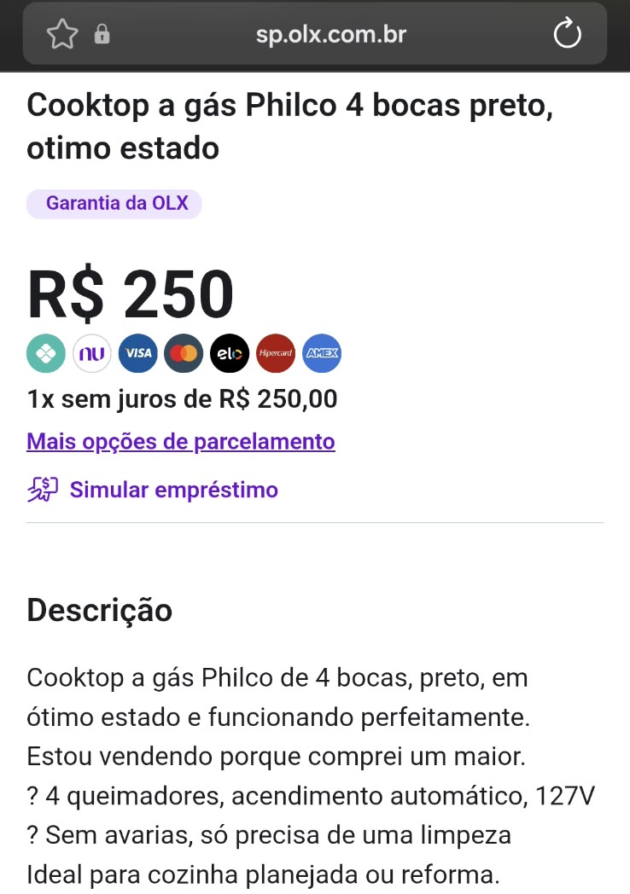

# Do Semestra ao Vende Fácil: Case de Product Discovery e Validação

> Dois ciclos de hipótese → experimento → evidência → decisão em **uma semana**. O primeiro produto não gerou nenhum interesse e foi pivotado. O segundo foi testado com pessoas reais medindo **ação**, não opinião, e revelou que o problema estava em outro lugar.

**Autor:** Wendel Macedo Ferreira · **Disciplina:** Metodologias Ágeis e Validação de Produtos · **Período:** 30/09 a 07/10/2026
**🎥 Vídeo pitch (3:58):** [https://youtu.be/L5ObLB5pzHE](https://youtu.be/L5ObLB5pzHE)

---

## Resumo em 30 segundos

| | Ciclo 1: Semestra | Ciclo 2: Vende Fácil |
|---|---|---|
| **Ideia** | IA transforma planos de ensino no cronograma do semestre | Manda a foto de algo parado em casa e recebe o preço e o anúncio prontos |
| **Público** | Universitários | Amigos e família com itens parados |
| **Experimento** | Landing page + formulário, divulgados em grupo da turma | Concierge (Mágico de Oz) por WhatsApp |
| **Resultado** | **0 inscrições em 29 pessoas, em 4 dias** | **1 de 5 tinha item parado; 1 de 2 que receberam o anúncio publicou no mesmo dia** |
| **Decisão** | **Pivotar** | **Abandonar a hipótese e pivotar para quem já anuncia e não vende** |

## Validação com usuários reais

Todas as conclusões vêm de **pessoas reais**, com as conversas registradas em prints das telas originais (só telefones, Pix e mensagens pessoais anteriores ficam cobertos).

| | Ciclo 1: Semestra | Ciclo 2: Vende Fácil |
|---|---|---|
| **Potenciais usuários reais alcançados** | **29** colegas da turma (grupo de WhatsApp com 30 membros) | **5** convidados: 4 amigos e 1 pessoa da família |
| **Reagiram** | 0 | **4 de 5** |
| **Completaram o teste** (problema → anúncio entregue) | 0 | **2 de 5** |
| **Avaliaram no formulário** | 0 | **2**, ambos com nota **5 de 5** e preço **"Justo"** |
| **Evidências** | [prints e registro](ciclo-1-semestra/04-evidencias/) | [prints, planilha, entregas e respostas](ciclo-2-vende-facil/04-evidencias/) |

**Ao todo, 34 potenciais usuários reais foram alcançados nos dois ciclos.** No Ciclo 2, os 5 convidados atendem ao mínimo da proposta. A baixa adesão (3 dos 5 não responderam às perguntas mesmo após 2 dias) **não foi descartada: foi tratada como dado** e pesou na decisão final, porque mostra que o problema não é urgente para esse público.

---

## Ciclo 1: Semestra (30/09 a 04/10)

**Problema:** universitários recebem prazos espalhados (PDF, AVA, WhatsApp) e são pegos de surpresa.
**Hipótese de valor:** ≥ 20% dos visitantes da landing page se inscreveriam para testar.

**Experimento:** landing page com formulário "Quero testar", divulgada no grupo de WhatsApp da turma (30 membros) → [hipóteses](ciclo-1-semestra/01-parte-teorica.md) · [landing](ciclo-1-semestra/03-experimento/landing-page/index.html) · [registro](ciclo-1-semestra/04-evidencias/registro-divulgacao.md)

**Resultado:** nenhuma inscrição, nenhuma pergunta e nenhuma reação no grupo em 4 dias ([evidências](ciclo-1-semestra/04-evidencias/)).

**Decisão: PIVOTAR** → [resultado e justificativa](ciclo-1-semestra/05-resultado-e-decisao.md)

**O que aprendemos e levamos para o Ciclo 2:**
1. Post em grupo não é recrutamento → **convite individual**.
2. Esforço inicial alto (buscar PDFs) mata a adesão → **pedir só uma foto**.
3. Opinião é fraca, especialmente de pessoas próximas → **medir uma ação** (publicar o anúncio).

---

## Ciclo 2: Vende Fácil (04/10 a 05/10)

### Problema
Quase toda casa tem objetos parados que o dono gostaria de vender, mas não vende por causa do **trabalho de começar**: descobrir o preço, escrever o anúncio, fotografar e negociar.

### Hipóteses
| # | Hipótese | Meta |
|---|---|---|
| H1 · Problema | Pessoas têm itens parados e não vendem por causa do preço/anúncio/trabalho | ≥ 60% |
| H2 · Solução | Preço + anúncio gerados por IA a partir de uma foto são úteis e confiáveis | Utilidade ≥ 4/5 e ≥ 60% acham o preço justo |
| **H3 · Valor** | **Com o anúncio pronto, as pessoas de fato anunciam** | **≥ 40% publicam até 06/10** |

Detalhes, MVP e regra de decisão: [01-parte-teorica.md](ciclo-2-vende-facil/01-parte-teorica.md) · Canvas: [02-canvas](ciclo-2-vende-facil/02-canvas/canvas.md)

### Experimento: concierge MVP
Nenhuma linha de código. O autor faz o papel do produto:
1. Pergunta sobre o problema, sem falar da solução → [mensagens](ciclo-2-vende-facil/03-experimento/mensagens-whatsapp.md)
2. Recebe a foto, gera preço e anúncio com IA ([prompt](ciclo-2-vende-facil/03-experimento/prompt-concierge.md)) e **confere o preço em 3 anúncios reais**
3. Entrega o anúncio pronto e, no dia seguinte, pergunta: **publicou?**
4. Formulário de 1 minuto → [perguntas](ciclo-2-vende-facil/03-experimento/formulario-avaliacao.md)

### Evidências
**5 pessoas reais** convidadas em 04/10 (4 amigos e 1 pessoa da família): 3 em um grupo de WhatsApp e 2 em conversas individuais. **2 testes completos** (V04: monitor; V05: cooktop), com checagem de preço em 3 anúncios reais da OLX para cada item. Tudo registrado em [04-evidencias/](ciclo-2-vende-facil/04-evidencias/), com os **prints reais das conversas** (só telefones, Pix e mensagens pessoais anteriores ficam cobertos).

| Anúncio original da V05 (no ar desde 01/10, sem venda) | Depois do Vende Fácil (republicado em 05/10) |
|---|---|
| "Cooktop 4 bocas", R$ 230, uma frase de descrição |  |

Reação do V04, 3 minutos depois de receber o anúncio: *"Vou postar agora mesmo no mercado livre"* · *"Ficou realmente bom agr"* ([print](ciclo-2-vende-facil/04-evidencias/prints/2026-10-05_reacao-V04.png))

### Resultados
| Hipótese | Meta | Resultado | Status |
|---|---|---|---|
| H1 | ≥ 60% (3 de 5) | **20%** (1 de 5 com item parado espontâneo) | ❌ |
| H2 · utilidade | ≥ 4/5 | **5 de 5** nos 2 que testaram (V04 e V05); os 2 usaram o texto quase sem mudança | ✅ entre quem testou |
| H2 · preço justo | ≥ 60% | **2 de 2** marcaram "Justo"; a V05 adotou o preço sugerido (subiu de R$ 230 para R$ 250); o preço da IA, antes da conferência, ficou 14% abaixo do mercado | ✅ entre quem testou |
| **H3 · publicou** | **≥ 40% (2 de 5)** | **20%** (1 de 5); 1 de 2 entre quem recebeu o anúncio | ❌ |

**Principais padrões** ([síntese completa](ciclo-2-vende-facil/05-analise/sintese.md)):
1. **Convite individual funciona, grupo não:** 2 de 2 testes completos vieram de conversas individuais, 0 de 3 do grupo.
2. **Anunciar não é difícil para quem respondeu.** A dor é anunciar e não vender: *"nao consigo vender"* (V05), *"Tive dificuldade para vender"* (V04).
3. **Quando o anúncio chega pronto, a ação é rápida:** o V04 respondeu em 3 minutos e a V05 republicou no mesmo dia, com o preço sugerido.
4. **Quem testou aprovou:** nota **5 de 5** e preço "Justo" nos 2 casos ([respostas do formulário](ciclo-2-vende-facil/04-evidencias/prints/form-curto-respostas-2.png)). A solução funciona; o problema estava no público.

### Decisão final
**ABANDONAR a hipótese inicial e pivotar o segmento.** Pela regra definida antes do teste, H1 abaixo de 40% leva a abandonar a hipótese, e ela ficou em 20%. O problema "dá trabalho anunciar" não apareceu. Os dados, porém, revelaram outro público com dor concreta e ação imediata: **quem já anuncia e não vende**.

**A baixa adesão também é um resultado.** Mesmo sendo amigos e família, mesmo com um serviço gratuito que pedia só uma foto, 3 dos 5 convidados não responderam às perguntas em 2 dias de espera, e 2 deles tinham prometido responder "quando chegar em casa". Pessoas com uma dor real costumam responder rápido, como fez a V05. O silêncio indica que, para esse público, ter coisas paradas em casa não é um problema urgente. Por isso o autor confirmou a decisão de abandonar a hipótese em vez de insistir com mais convites para o mesmo perfil.

**Próximo passo recomendado:** novo ciclo de 2 semanas com 10 pessoas que têm anúncio parado há mais de 7 dias, recrutadas individualmente. Oferta: "manda o link do seu anúncio que eu te devolvo uma versão melhor". Métricas: % que atualiza (meta ≥ 50%) e % que vende em até 7 dias.

---

## Aprendizados do processo
- **Confirmado:** convite individual e esforço mínimo (uma foto) geram resposta. Quando o anúncio chega pronto, quem tem a dor age no mesmo dia, e avalia a solução com nota máxima (5 de 5, n = 2).
- **Contrariado:** a ideia de que "anunciar dá trabalho". Quem respondeu acha fácil. A dor real está em **não conseguir vender**. A IA também errou o preço para baixo nos dois casos, o que mostra que a conferência humana é parte do produto.
- **Sobre o método:** testar barato e rápido permitiu descartar a primeira ideia em 4 dias, sem escrever código.

## Uso de IA
A IA apoiou a geração de ideias (inclusive as do pivô), a estruturação de hipóteses, a execução dos concierges e o agrupamento de feedbacks. **Nenhuma conclusão se apoia em respostas de IA**: todas vêm do que pessoas reais disseram e, principalmente, **fizeram**. Registro completo: [diario-ia.md](diario-ia.md).

## Estrutura do repositório
```
README.md                  O case completo
CRONOGRAMA.md              Plano da semana (incluindo o pivô)
diario-ia.md               Como a IA foi usada, e onde a decisão foi humana
ciclo-1-semestra/          Hipóteses, canvas, landing, evidências e decisão de pivotar
ciclo-2-vende-facil/       Hipóteses, canvas, concierge, evidências e síntese
```
